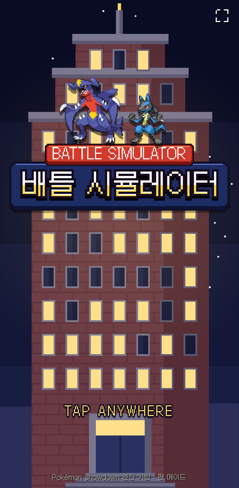
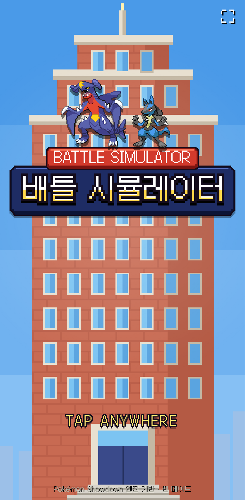
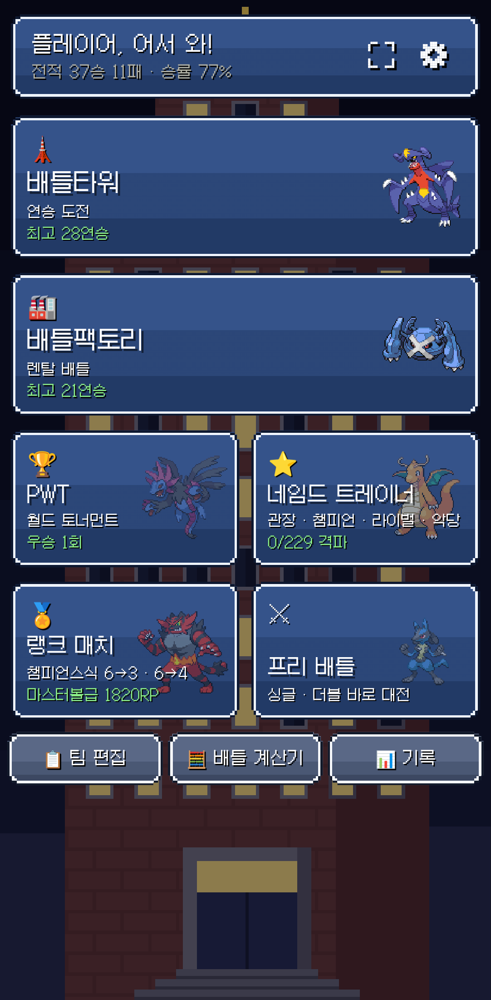
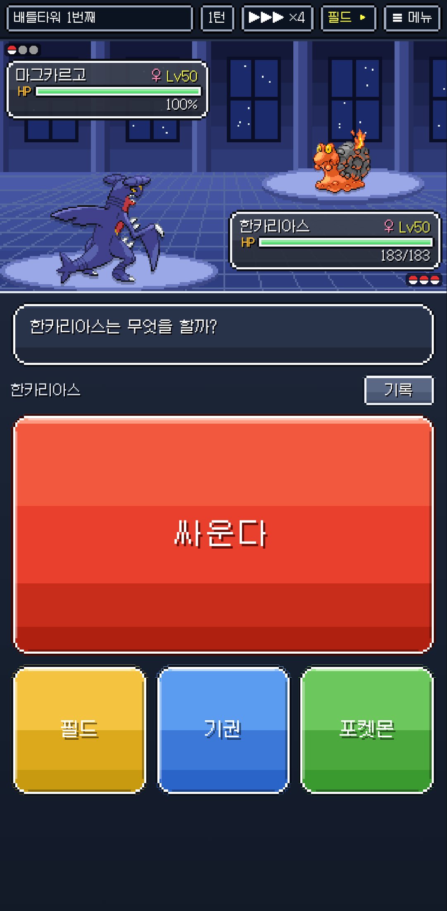
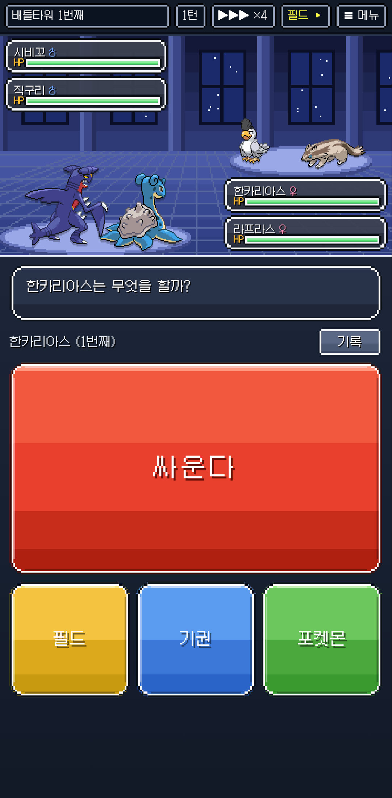
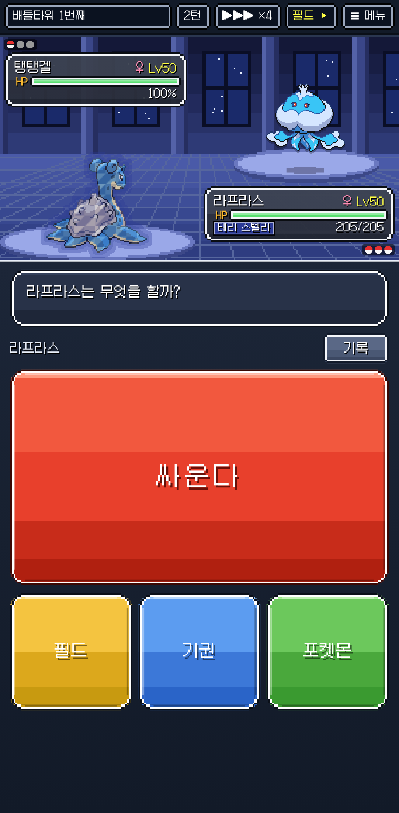
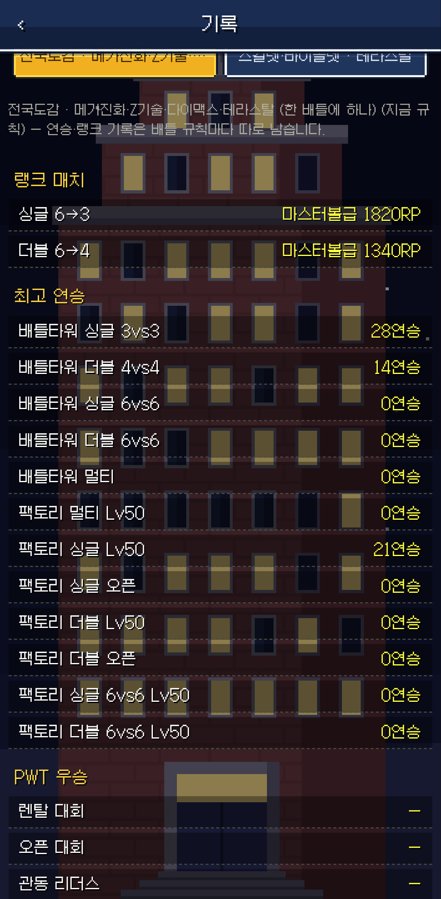
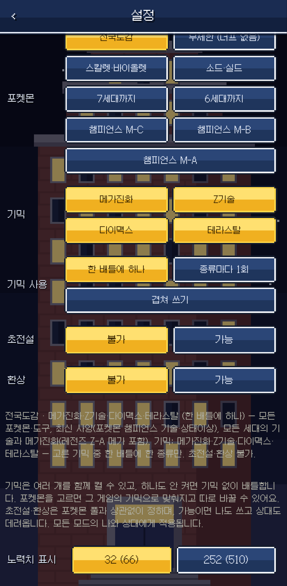
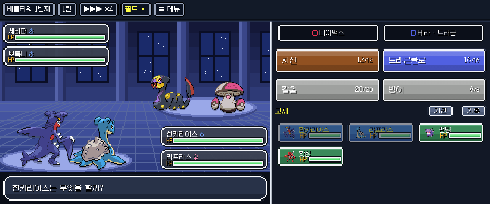
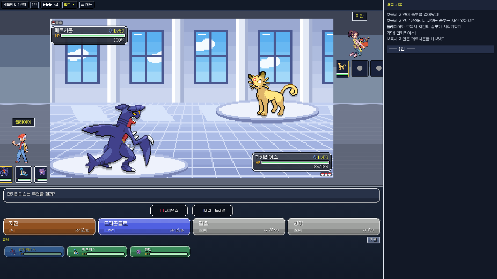

# 배틀시뮬 KR v2.48.0 — 변경 사항 (v2.26.1 이후)

마지막 배포 v2.26.1 → v2.48.0 (versionCode 126)
APK: `battle-kr/release/BattleSimKR-v2.48.0.apk` · 웹: GitHub Pages

> 기존 설치본 위에 그대로 업데이트할 수 있습니다(같은 서명 키). 팀·기록·리플레이·진행 중인 연승 도전은 그대로 이어집니다.

---

## 한눈에 보기

- **새 타이틀 화면**: 하늘에 솟은 배틀타워와 도트 로고, 점멸하는 TAP ANYWHERE. **낮/밤 시간대 테마** 추가.
- **배틀 규칙을 네 가지로 조합**: 포켓몬 풀(전국도감·무제한·스칼렛바이올렛·소드실드·7/6세대까지·챔피언스 M-C/M-B/M-A) × 기믹(여러 개 선택) × 초전설 × 환상.
- **세대별 사양 재현**: 고른 풀의 그때 종족값·특성·기술 수치·배울 수 있는 기술·도구, 그리고 **그 세대의 특성 동작**(불요의검 매번, 질풍날개 HP 무관, 스킨 1.3배 등)과 **싸라기눈/설경** 날씨까지.
- **화면 배치 3종**: 휴대폰 세로, **휴대폰 가로(하이브리드)**, **PC 넓은 화면(쇼다운식)**. 모든 화면에서 필드는 16:9.
- **연출 강화**: 볼마다 컨셉이 다른 등장 이펙트, 테라스탈 보석 결, 다이맥스 붉은 빛, 기술 준비 연출, 빗나감·방어 시 연출 생략.
- **3세대풍 새 칩튠 곡 7곡** + 밝은 로비 곡, 배틀 음악·배경을 승부 직전에 고르기.
- **타워·팩토리 난이도**(쉬움/보통/어려움), 연승 단계 제한, **규칙별 기록**.
- **AI 개선**과 다수의 오류 수정.

---

## 배틀 규칙 · 데이터

- 배틀 규칙을 **포켓몬 풀 · 기믹 · 초전설 · 환상** 네 가지로 나눠 조합합니다. 기믹(메가진화·Z기술·다이맥스·테라스탈 등)은 여러 개 고를 수 있고, 둘 이상이면 쓰는 방식(한 배틀에 하나 / 종류마다 1회 / 겹쳐 쓰기)을 고릅니다. 예전 규칙은 같은 조합으로 자동 변환됩니다.
- **포켓몬 풀별 그때 사양**: 종족값·타입·특성·기술 위력·명중·PP·배울 수 있는 기술·도구가 그 게임 기준이 됩니다. 상대 팀(무작위·랭커·렌탈)도 풀에 맞춥니다.
- **무제한(너프 없음)** 풀: 세대 중 가장 강한 종족값, 모든 세대의 특성, 가장 높은 위력·명중·PP. 상태이상(마비 1/8·잠듦·얼음)·날씨·필드는 챔피언스 방식입니다.
- **세대별 특성 동작**(쇼다운의 그 세대 동작을 사용, 설명도 함께 바뀜)
  - 8세대 이하: 불요의검·불굴의방패 나올 때마다, 변환자재·리베로 기술마다, 트랜지스터 1.5배, 배틀스위치(지우개굴닌자), 눈퍼뜨리기 → 싸라기눈
  - 7세대 이하: 정신력·둔감·마이페이스·배짱이 위협을 막지 않음, 주눅이 위협에 반응하지 않음, 탈은 데미지 없이 막음, 변덕쟁이는 명중·회피도 오름
  - 6세대: 질풍날개 HP 무관, 스카이스킨·페어리스킨·프리즈스킨 1.3배, 깨어진갑옷 스피드 +1, 부모유대 2번째 공격 1/2, 짓궂은마음이 악타입에게도 통함
  - 무제한: 위 중 더 강했던 쪽 / 챔피언스 사양: 치유의마음 50%, 도주(교체를 막는 효과 무시), 보이지않는주먹
- **싸라기눈 / 설경 구별**: 8세대 이하 룰은 싸라기눈(매 턴 데미지), 9세대·챔피언스는 설경. 기술·날씨 이름도 따로 표시합니다.
- 챔피언스 사양에서 효과가 바뀐 기술(소금절이 1/16, 골드러시 특공 −2, 아이언헤드 풀죽음 20% 등)은 설명도 챔피언스 기준입니다.

## 타이틀 · 테마

- 새 타이틀: 하늘에 솟은 벽돌 배틀타워, 남색 판·붉은 탭의 도트 로고, 로고 위에 선 한카리아스·루카리오(3D 설정이어도 타이틀은 2D), 점멸하는 **TAP ANYWHERE**.
- **시간대 테마**(설정 → 시간대: 밤 / 낮 / 시간에 따라): 타이틀·메뉴 배경과 배틀타워·팩토리·경기장 배틀 배경이 낮 그림으로 바뀝니다.
- 새 배틀 배경 5종(동굴·바닷가·설원·화산·체육관), 네임드 대전은 상대 주력 타입에 맞는 배경.

## 배틀 화면

- **모든 화면에서 필드 16:9**: 위쪽 빈 하늘을 잘라 HP 창이 배경 위에 겹쳐 보이고 필드가 더 넓어졌습니다.
- **더블·멀티 HP 창**: 이름/HP 바 두 줄의 얇은 창, 볼 현황 줄 제거. HP 창에는 상태이상·테라만 표시하고 랭크 변화·혼란 등은 **필드 메뉴**에서 봅니다(화면에 보인 상태 기준, 상대의 숨은 정보는 보이지 않음).
- **휴대폰 가로 화면**(자동 회전을 켜면): 왼쪽 큰 필드와 그 아래 대화창, 오른쪽에 기믹·기술 2×2·교체 6칸·기권·기록을 한 번에. 작은 화면(예: 600×270)에서도 깨지지 않게 버튼이 화면에 맞춰 줄어듭니다.
- **PC 넓은 화면**: 쇼다운식 배치(필드 아래 기술·교체 함께, 오른쪽 배틀 기록), 필드 양옆 트레이너·파티 현황과 배경 색 띠, 마우스를 올리면 포켓몬·기술 정보 상자(교체 버튼 포함), 키보드 조작, 웹에서 배틀 중 창을 닫을 때 확인창.
- **더블·멀티 대상 고르기**: 모든 기술에 대상 확인 화면, 새 카드 디자인(편 색 띠·여러 대상은 선으로 연결).
- 일루전 조로아크가 둔갑한 동안 기술 상성이 진짜 타입으로 계산돼 정체가 드러나던 문제 수정.
- 대화창 높이 고정, 긴 글은 글자 크기를 줄여 맞춤. '급소에 맞았다!'는 노란 글자.

## 연출 · 그림

- **볼 등장 이펙트**: 볼마다 컨셉이 다른 입자 모양·움직임(러브러브볼 하트, 퀵볼 섬광 등).
- **테라스탈**: 그림 모양대로 반투명한 보석 결 + 타입 색 바깥 빛(스텔라는 남색). **다이맥스**: 붉은 바깥 빛이 은은하게 점멸.
- **기술 준비 연출**: 힘껏펀치·부리캐논·트랩셸, 솔라빔 같은 2턴 기술의 준비 턴. 쾌청 솔라빔 등 바로 쓰는 경우도 기술 연출이 나옵니다.
- 빗나가거나 방어·무효로 막힌 기술은 기술 연출을 생략합니다.
- 포켓몬 그림 크기 보정: 메가진화가 기본 모습보다 작아 보이지 않게(예: 메가대여르), 3D 그림이 없어 도트로 나오는 포켓몬도 크기를 맞춤. 레전즈 Z-A 메가는 웹에서도 메가 그림.
- 9세대 임시 그림 16종을 도트 그림으로 교체.

## 음악 · 소리

- **GBA 풍 칩튠 음원**과 새로 작곡한 **3세대풍 배틀 곡 7곡**(트레이너·관장·배틀 프런티어·라이벌·악의 조직·프런티어 브레인·챔피언), 밝은 로비·타이틀 곡, PWT 대진표 전용 곡.
- 배틀 음악·배경을 **승부 직전 화면에서 ◀ ▶ 로 고르고 미리 듣기**(기본/무작위/없음/곡 지정).
- 리플레이를 보다 나가면 효과음이 멈추도록 수정.

## 배틀타워 · 팩토리 · 모드

- **난이도**(쉬움 / 보통 / 어려움): 쉬움은 일반 포켓몬 게임의 배틀시설 정도. 난이도마다 도전·기록이 따로.
- 쉬었다 와도 **같은 상대**가 나옵니다(다음 상대 저장). 규칙을 바꾸면 새 규칙으로 다시 뽑습니다.
- **연승 단계 제한**: 연승에 따라 상대 종족값 상한·메가/Z 허용 시점이 열립니다. 첫 타워 타이쿤 전 네임드는 메가·Z 없음.
- **미진화체는 쉬움에서만**(성능 좋은 미진화체 — 폴리곤2·럭키 등 — 는 예외).
- 팩토리 렌탈 등급을 난이도별 사다리로, 등급 이름은 브론즈~레전드.
- **규칙별 기록**: 연승·랭크 기록과 진행 중인 도전이 배틀 규칙마다 따로 저장되고, 기록 화면에서 규칙별로 봅니다.
- **치트 팀**은 같은 포켓몬을 여러 마리 넣을 수 있습니다.
- 네임드 트레이너 추가: 배틀샤틀레느 4자매, 신오 프런티어 브레인 5명, 용규.
- PWT 대진표 새 디자인, 멀티배틀에서 파트너·상대 둘째 트레이너 그림.

## AI

- 상대 선택을 미리 엿보던 동작 제거(공정한 동시 선택).
- 강한 AI가 앞을 내다보는 계산에서 다이맥스를 쓰지 못하던 문제 수정 — 이제 다이맥스도 계산해서 씁니다.
- 한 턴 계산 시간을 최대 1.6초로 제한해 저사양 휴대폰에서 화면이 오래 멈추지 않게 했습니다.

## 오류 수정 (주요)

- 챔피언스 룰에서 펌킨인 크기 폼 등 12종이 기술 0개로 배틀이 시작되지 않던 오류
- 무제한 룰의 코스모그·코스모움 기술 0개 오류
- 팩토리에서 이긴 뒤 교환 화면에서 앱을 끄면 같은 승부를 다시 하던 문제
- 좁은 조건(타입 구애 등)에서 상대 팀 마릿수가 모자라던 문제, 초반에 강한 포켓몬이 나오던 문제
- 킹실드·토치카 등에 막혀도 기술 연출이 나오던 문제
- 연출 중 메인 메뉴로 나가면 메뉴에서 승리 음악이 나오던 문제
- 혼연일체 특성 이름이 영어로 나오던 문제, 더블 동시 기절·대상 카드 표시 등

---

## 스크린샷

| | |
|---|---|
|  |  |
| 새 타이틀 — 밤 | 새 타이틀 — 낮 테마 |
|  |  |
| 메인 메뉴 | 싱글 배틀 (16:9 필드) |
|  |  |
| 더블 배틀 (두 줄 HP 창) | 테라스탈 보석 결 (스텔라) |
|  |  |
| 규칙별 기록 | 배틀 규칙 설정 |

휴대폰 가로 — 하이브리드 배치

PC 넓은 화면 — 쇼다운식 배치 (낮 테마)
